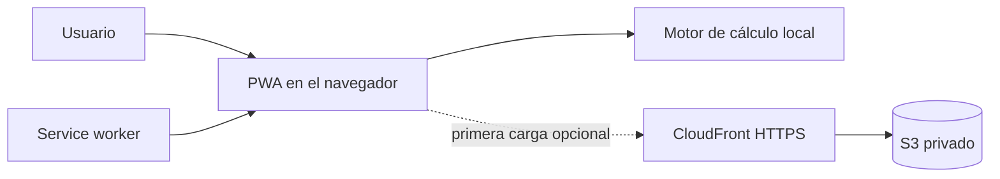

# Calculadora de Varillas

PWA sin dependencias que calcula **cuántas varillas longitudinales necesita una columna de concreto armado**, cómo distribuirlas y si la separación básica cumple la NTP E.060 (Perú), concordante con ACI 318.

> **Uso académico.** No reemplaza el análisis estructural completo, el diagrama de interacción P–M ni la revisión de un ingeniero estructural responsable.

## Repositorio público

El código público vive en [`ErickrU/calculadora-varillas-pwa`](https://github.com/ErickrU/calculadora-varillas-pwa). Este repositorio no registra ni afirma que exista un despliegue AWS activo. Incluye infraestructura genérica para publicar una instancia propia; consulta la [plantilla de estado](docs/DEPLOYMENT-STATUS.md) y la [guía segura de AWS](docs/AWS-DEPLOYMENT.md).

`"private": true` en `package.json` solo evita una publicación accidental en npm; no controla la visibilidad del repositorio en GitHub.

## Características

- columnas rectangulares, circulares con estribos y circulares con espiral;
- cálculo por cuantía longitudinal (`1 %–6 %`) o carga axial última `Pu`;
- seis diámetros de barras corrugadas y selección automática de estribo;
- mínimo normativo de barras, armado simétrico y separación libre;
- diagrama SVG de la sección a escala y tabla de alternativas;
- validación accesible asociada a cada campo;
- diseño adaptable para celular y escritorio, con tema oscuro o claro persistente;
- barra accesible con cinco controles: instalar, compartir, cambiar tema, restablecer y abrir ayuda;
- integración con Window Controls Overlay al instalarla y cabecera completa de respaldo en pestañas y navegadores sin esa API;
- instalable y completamente funcional sin conexión después de la primera visita;
- cálculo local: no envía ni almacena los datos del formulario;
- despliegue reproducible en AWS con S3 privado, CloudFront y OAC.

## Inicio rápido

Requiere Node.js 20 o posterior solo para el servidor local. La aplicación no instala paquetes.

```bash
git clone https://github.com/ErickrU/calculadora-varillas-pwa.git
cd calculadora-varillas-pwa
npm start
```

Abre [http://localhost:8080](http://localhost:8080). Los service workers requieren `localhost` o HTTPS; no abras `index.html` directamente con `file://`.

## Datos solicitados

| Paso | Dato | Valores/unidad |
|---|---|---|
| 1 | Tipo de columna | Rectangular con estribos, circular con estribos o circular con espiral |
| 2 | Dimensiones | `b × h` o `D`, en cm |
| 3 | Materiales | `f'c` y `fy`, en kgf/cm² |
| 4 | Criterio | Cuantía `ρ` o carga axial última `Pu` en tonf |
| 5 | Armado | Diámetro longitudinal y recubrimiento en cm |

## Ejemplo

Para `30 × 50 cm`, `ρ = 1 %` y barras de `5/8"`:

```text
Ag            = 1,500.00 cm²
As requerido  = 15.00 cm²
Resultado     = 8 varillas de 5/8"
As colocado   = 16.00 cm²
ρ colocado    = 1.07 %
Distribución  = 3 barras por cada cara b y 3 por cada cara h
```

Las cuatro barras de esquina pertenecen a dos caras; no se suman dos veces.

## Documentación

- [Cálculos, unidades, ecuaciones y limitaciones](docs/CALCULATIONS.md)
- [Arquitectura de la PWA y de AWS](docs/ARCHITECTURE.md)
- [Plantilla de estado local de despliegue](docs/DEPLOYMENT-STATUS.md)
- [Despliegue y operación segura en AWS](docs/AWS-DEPLOYMENT.md)
- [Guía para contribuir](CONTRIBUTING.md)
- [Política de seguridad](SECURITY.md)

## Arquitectura resumida



`js/calculo.js` contiene la lógica pura; `js/app.js` adapta el formulario y genera el resultado/diagrama; `sw.js` conserva el app shell para uso offline. En un despliegue AWS propio, CloudFront es el único endpoint público y lee S3 mediante Origin Access Control.

## Estructura

```text
calculadora-varillas-pwa/
├── .github/                 Plantillas del repositorio
├── docs/
│   ├── ARCHITECTURE.md      Componentes y decisiones
│   ├── AWS-DEPLOYMENT.md    Despliegue, verificación y operación
│   ├── DEPLOYMENT-STATUS.md Plantilla para estado local no versionado
│   └── CALCULATIONS.md      Fórmulas, unidades y limitaciones
├── infra/
│   └── cloudformation.yaml  S3 privado + CloudFront OAC
├── scripts/
│   ├── deploy-aws.sh        Revisión y despliegue con confirmaciones
│   ├── destroy-aws.sh       Elimina un stack verificado; no purga el bucket retenido
│   └── verify-site.sh       Smoke test HTTPS sin credenciales
├── css/estilos.css
├── js/
│   ├── calculo.js           Motor de cálculo sin DOM
│   ├── app.js               Interfaz y diagrama SVG
│   └── registro-sw.js       Instalación, actualización y conexión
├── iconos/                  Fuentes SVG y PNG para la PWA
├── herramientas/            Servidor local y generador de iconos
├── index.html
├── offline.html
├── manifest.webmanifest
└── sw.js
```

## PWA y actualizaciones

- El manifest declara iconos `any` y `maskable` y modo `standalone`.
- El service worker precachea los archivos necesarios para calcular sin red.
- Al cambiar el app shell, incrementa `VERSION` en `sw.js`; la interfaz avisará cuando la actualización esté lista.
- Los datos de entrada nunca abandonan el dispositivo.

Para regenerar iconos después de editar los SVG:

```bash
npm run iconos
```

## AWS

La infraestructura usa CloudFormation. Prefiere credenciales temporales obtenidas mediante SSO o un rol de mínimo privilegio. Revisa siempre la identidad y cuenta activas antes de aplicar cambios; evita credenciales administrativas para el uso habitual. `--profile <YOUR_AWS_PROFILE>` es opcional: si se omite, AWS CLI usa su cadena estándar de credenciales.

Primero ejecuta únicamente el modo de revisión, sin `--apply`:

```bash
./scripts/deploy-aws.sh \
  --profile <YOUR_AWS_PROFILE> \
  --region <YOUR_AWS_REGION> \
  --stack <YOUR_STACK_NAME> \
  --environment <YOUR_ENVIRONMENT>
```

No guardes credenciales en el repositorio ni versiones `.aws-deployment.json`, outputs, nombres físicos o estado local. El modo de escritura exige confirmar la cuenta y el hash exacto de la plantilla. Lee [docs/AWS-DEPLOYMENT.md](docs/AWS-DEPLOYMENT.md) antes de usarlo.

## Licencia

[MIT](LICENSE) © 2026 ErickrU.
