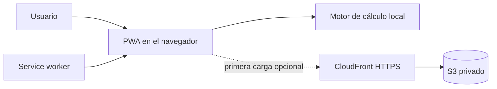

# Calculadora de Varillas

PWA sin dependencias que calcula **cuántas varillas longitudinales necesita una columna de concreto armado**, cómo distribuirlas y si la separación básica cumple la NTP E.060 (Perú), concordante con ACI 318.

> **Uso académico.** No reemplaza el análisis estructural completo, el diagrama de interacción P–M ni la revisión de un ingeniero estructural responsable.

## Repositorio público

El código público vive en [`ErickrU/calculadora-varillas-pwa`](https://github.com/ErickrU/calculadora-varillas-pwa). Este repositorio no registra ni afirma que exista un despliegue AWS activo. Incluye infraestructura genérica para proponer una creación nueva; consulta la [plantilla de estado](docs/DEPLOYMENT-STATUS.md) y la [guía segura de AWS](docs/AWS-DEPLOYMENT.md).

`"private": true` en `package.json` solo evita una publicación accidental en npm; no controla la visibilidad del repositorio en GitHub.

## Características

- columnas rectangulares, circulares con estribos y circulares con espiral;
- cálculo por cuantía longitudinal (`1 %–6 %`) o carga axial última `Pu`;
- seis diámetros de barras corrugadas y selección automática de estribo;
- mínimo normativo de barras, armado simétrico y separación libre;
- diagrama SVG de la sección a escala y tabla de alternativas;
- validación accesible asociada a cada campo;
- diseño adaptable para celular y escritorio, con tema oscuro o claro persistente;
- barra accesible con exactamente cinco controles: instalar, compartir, cambiar tema, restablecer y abrir ayuda;
- integración con Window Controls Overlay al instalarla y cabecera completa de respaldo en pestañas y navegadores sin esa API;
- hoja propia de Compartir con WhatsApp, Telegram, Facebook, X, Correo y copia explícita, siempre a partir de `window.location.href`;
- «Más apps» abre Web Share solo cuando el navegador lo ofrece, sin enumerar aplicaciones instaladas; cancelar no copia y los fallos de Clipboard terminan en `execCommand('copy')` o selección manual;
- instalable y completamente funcional sin conexión después de la primera visita;
- cálculo local: no envía ni almacena los datos del formulario;
- alternativa AWS con S3 privado, CloudFront y OAC.

## Inicio rápido

Requiere Node.js 20 o posterior solo para el servidor local. La aplicación no instala paquetes.

```bash
git clone https://github.com/ErickrU/calculadora-varillas-pwa.git
cd calculadora-varillas-pwa
npm run check
npm test
npm start
```

Abre [http://127.0.0.1:8080](http://127.0.0.1:8080). El servidor escucha únicamente en loopback. Los service workers requieren un contexto seguro; no abras `index.html` directamente con `file://`.

## Datos solicitados

| Paso | Dato | Valores/unidad |
|---|---|---|
| 1 | Tipo de columna | Rectangular con estribos, circular con estribos o circular con espiral |
| 2 | Dimensiones | `b × h` o `D`, en cm |
| 3 | Materiales | `f'c` y `fy`, en kgf/cm² |
| 4 | Criterio | Cuantía `ρ` o carga axial última `Pu` en tonf |
| 5 | Armado | Diámetro longitudinal y recubrimiento en cm |

## Ejemplo

Para `30 × 50 cm`, `ρ = 1 %` y barras de `5/8"`:

```text
Ag            = 1,500.00 cm²
As requerido  = 15.00 cm²
Resultado     = 8 varillas de 5/8"
As colocado   = 16.00 cm²
ρ colocado    = 1.07 %
Distribución  = 3 barras por cada cara b y 3 por cada cara h
```

Las cuatro barras de esquina pertenecen a dos caras; no se suman dos veces. Este caso está protegido por una prueba de regresión.

## Documentación

- [Cálculos, unidades, ecuaciones y limitaciones](docs/CALCULATIONS.md)
- [Arquitectura de la PWA y de AWS](docs/ARCHITECTURE.md)
- [Estado local de despliegue](docs/DEPLOYMENT-STATUS.md)
- [Despliegue y operación segura en AWS](docs/AWS-DEPLOYMENT.md)
- [Guía para contribuir](CONTRIBUTING.md)
- [Política de seguridad](SECURITY.md)

## Arquitectura resumida



`js/calculo.js` contiene la lógica pura; `js/app.js` adapta el formulario y genera el resultado/diagrama; `sw.js` conserva el app shell para uso offline. En una creación AWS propia, CloudFront es el único endpoint público y lee S3 mediante Origin Access Control.

## Estructura

```text
calculadora-varillas-pwa/
├── .github/workflows/pages.yml Artefacto público exacto de GitHub Pages
├── docs/                       Cálculos, arquitectura y despliegue
├── infra/
│   ├── cloudformation.yaml     S3 privado + CloudFront OAC
│   └── stack-policy.json       Denegación fail-closed de updates
├── scripts/
│   ├── aws-proof.mjs           Reglas puras de evidencia
│   ├── validate-aws-proof.mjs  Constructor/validador local
│   ├── deploy-aws.sh           Review, prepare y execute separados
│   └── verify-site.sh          Verificación HTTPS anónima
├── tests/                      Regresión de cálculo, PWA y fixtures AWS sintéticos
├── css/estilos.css
├── js/
│   ├── calculo.js              Motor de cálculo sin DOM
│   ├── app.js                  Interfaz y diagrama SVG
│   └── registro-sw.js          Instalación, actualización y capacidades PWA
├── iconos/
├── herramientas/               Servidor local y generador de iconos
├── index.html
├── offline.html
├── manifest.webmanifest
└── sw.js
```

## PWA y actualizaciones

- El manifest declara iconos `any` y `maskable`, modo `standalone` y Window Controls Overlay.
- El service worker precachea los 13 archivos publicables necesarios para calcular sin red.
- Al cambiar el app shell, incrementa `VERSION` en `sw.js`; la interfaz avisará cuando la actualización esté lista.
- Los datos de entrada nunca abandonan el dispositivo.

## Alternativa AWS

Este workflow preparó y verificó el código solo localmente: **no hizo llamadas AWS**. Los nombres reales no se guardan en el repositorio: cada operación futura exige `--stack-name <AUTHORIZED_STACK_NAME>` y `--blocked-stack-name <BLOCKED_STACK_NAME>`. Ambos deben ser distintos; si no puede demostrarse la ausencia del target autorizado, el resultado es `STOP`, sin update, nombre alternativo, eliminación ni cleanup.

Una operación futura comienza obteniendo hashes de commit, plantilla e identidad:

```bash
./scripts/deploy-aws.sh \
  --phase review \
  --stack-name <AUTHORIZED_STACK_NAME> \
  --blocked-stack-name <BLOCKED_STACK_NAME> \
  --profile <YOUR_AWS_PROFILE> \
  --region <YOUR_AWS_REGION>
```

`review` consultará la identidad AWS cuando una persona autorizada lo ejecute. `prepare` requiere hashes aprobados, genera internamente nombre y client token, usa `CREATE` con `DO_NOTHING` y conserva evidencia privada `0700/0600`. `execute` exige otra autorización, repite toda la validación con un snapshot TOCTOU de máximo 300 segundos y solo entonces crea los cinco recursos. No existe ruta de actualización, eliminación o limpieza.

`DO_NOTHING`, el versionado y `Retain/Retain` pueden dejar recursos parciales y costos. Preparar, ejecutar y cualquier recuperación posterior requieren decisiones trazables separadas. No guardes credenciales, evidencia privada, cuentas, ARN, nombres físicos, tokens, outputs ni URL de recursos en Git.

## Licencia

[MIT](LICENSE) © 2026 ErickrU.
