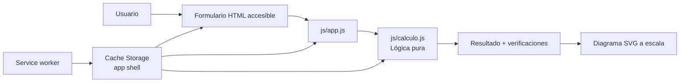
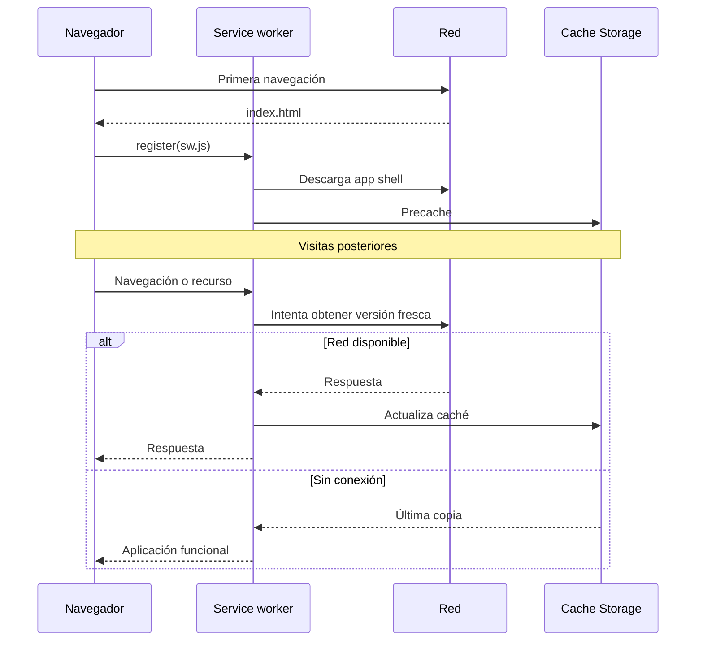
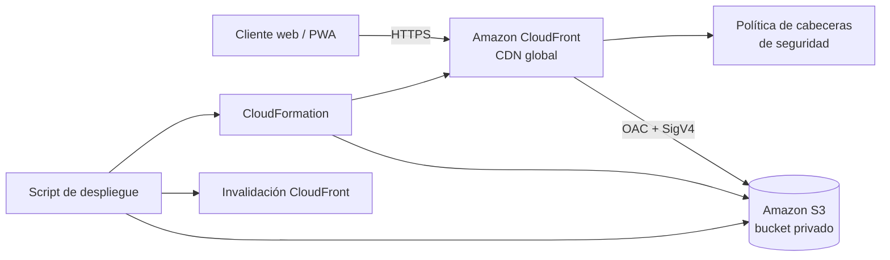

# Arquitectura

## 1. Objetivo

Calculadora de Varillas es una PWA estática para estimar el refuerzo longitudinal de columnas de concreto armado. Debe funcionar en navegadores modernos, instalarse como aplicación y conservar todas sus funciones sin conexión después de la primera visita.

No requiere backend: los datos ingresados se procesan localmente y no se almacenan ni transmiten.

## 2. Arquitectura de la aplicación

### Componentes

| Componente | Responsabilidad |
|---|---|
| `index.html` | Estructura semántica, datos solicitados y panel de resultados |
| `js/calculo.js` | Validación, fórmulas, distribución y alternativas; no usa DOM |
| `js/app.js` | Adaptador entre formulario, motor de cálculo y presentación |
| `js/registro-sw.js` | Instalación, compartir, tema, ayuda, Window Controls Overlay, conexión y actualización de la PWA |
| `sw.js` | Precache del app shell y estrategias de respuesta offline |
| `manifest.webmanifest` | Nombre, colores, iconos y comportamiento instalable con WCO y `standalone` |
| `css/estilos.css` | Temas, diseño adaptable, barra WCO, estados, foco visible y página offline |

La separación del motor (`calculo.js`) permite verificar las fórmulas sin un navegador y evita que la presentación altere el resultado numérico. La cabecera ofrece exactamente cinco controles accesibles: instalar, compartir, tema, restablecer y ayuda. El restablecimiento invoca el evento nativo del formulario para reutilizar la limpieza implementada por `app.js`.

Cuando la PWA instalada expone `navigator.windowControlsOverlay`, la cabecera usa las cuatro variables `titlebar-area-*`, zonas `drag`/`no-drag` y sincronización de `geometrychange` con 200 ms de espera. Si el rectángulo es angosto, la cabecera pasa a una fila inferior para no solapar los controles del sistema. Una pestaña normal o un navegador sin la API conserva la misma barra como cabecera web.

## 3. Flujo de cálculo

1. El formulario solicita geometría, materiales, método y varilla.
2. `app.js` normaliza los datos y llama a `calcularColumna`.
3. `calculo.js` valida rangos, calcula `Ag`, determina `As`, redondea el número de barras y comprueba la separación.
4. Si la entrada no es válida, la interfaz enlaza cada mensaje con su control y mueve el foco al primer error.
5. Si es válida, la interfaz presenta la propuesta, observaciones, alternativas y un SVG generado a la misma escala de la sección.

Las fórmulas, unidades y limitaciones están en [`CALCULATIONS.md`](CALCULATIONS.md).

## 4. Ciclo de vida PWA

`VERSION` en `sw.js` identifica el cache del shell. Al incrementarla, el nuevo worker instala recursos y la interfaz ofrece actualizar; los caches antiguos se eliminan durante `activate`.

## 5. Arquitectura AWS

### Recursos y límites de confianza

- **S3** es almacenamiento de origen, no endpoint público de sitio web. Block Public Access permanece activo.
- **CloudFront** es el único punto público. OAC firma las solicitudes a S3 y la política del bucket limita lectura al ARN de esa distribución.
- **CloudFormation** crea recursos de forma reproducible; no contiene credenciales.
- **El navegador** recibe solo archivos estáticos. No existen APIs ni datos personales del lado servidor.

### Decisiones

1. **OAC en lugar de OAI**: OAC es el mecanismo actual y usa credenciales SigV4 de corta duración.
2. **S3 privado en lugar de website endpoint**: evita publicar el bucket y permite HTTPS entre CloudFront y S3.
3. **Nombre de bucket generado por CloudFormation**: evita colisiones globales y no filtra identificadores del usuario.
4. **SSE-S3 explícito**: los objetos quedan cifrados sin introducir una clave KMS ni su costo/operación para un sitio público sin datos sensibles.
5. **Versionado y `DeletionPolicy: Retain`**: protege contra sobrescritura y borrado accidental; la limpieza debe ser una decisión separada.
6. **Cifrado de transporte**: el comportamiento predeterminado redirige HTTP a HTTPS. Con el dominio `cloudfront.net`, AWS fija la política TLS del certificado administrado; para controlar una versión mínima se necesita dominio propio y certificado ACM.
7. **Sin dominio personalizado inicialmente**: la URL `cloudfront.net` ya usa HTTPS; agregar dominio requiere control DNS y un certificado ACM en `us-east-1`.
8. **Sin registro detallado por defecto**: reduce datos y costo en un proyecto académico. Para producción, evalúa CloudFront standard logging, retención, acceso y presupuesto antes de activarlo.

## 6. Seguridad y privacidad

La política de respuesta establece CSP sin scripts remotos ni inline, HSTS, `X-Content-Type-Options`, `Frame-Options`, `Referrer-Policy` y `Permissions-Policy`. La página offline debe respetar la misma CSP.

Amenazas consideradas:

| Riesgo | Control |
|---|---|
| Acceso directo o listado del bucket | Block Public Access + política exclusiva para OAC |
| Tráfico sin cifrar | HTTP→HTTPS en CloudFront y OAC con firma permanente; dominio propio + ACM si se debe fijar una versión TLS mínima |
| Eliminación accidental | Versionado + retención de CloudFormation |
| Publicación de archivos internos | El script carga una allowlist explícita de archivos de la app |
| Código remoto comprometido | Sin dependencias ni CDN de terceros; CSP `self` |
| Despliegue en cuenta equivocada | Comprobación de cuenta y confirmación explícita en el script |
| Resultados de cálculo enviados fuera | Cálculo 100 % local, sin red ni telemetría |

## 7. Restricciones

- No modela interacción P–M, esbeltez, segundo orden, cortante, confinamiento sísmico completo ni cimentación.
- No hay sincronización entre dispositivos.
- No hay observabilidad de negocio porque no hay backend.
- El URL de CloudFront puede tardar varios minutos en estar disponible o actualizarse.
