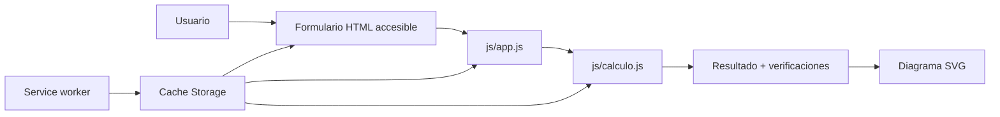
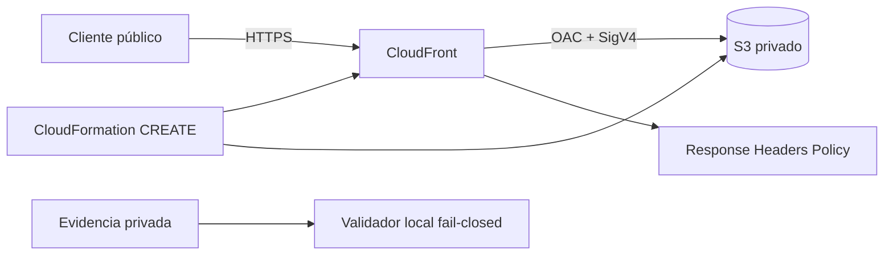

# Arquitectura

## 1. Aplicación

Calculadora de Varillas es una PWA estática para estimar el refuerzo longitudinal de columnas de concreto armado. Los datos se procesan localmente; no hay backend, almacenamiento remoto ni telemetría.

| Componente | Responsabilidad |
|---|---|
| `index.html` | Estructura semántica, datos solicitados y panel de resultados |
| `js/calculo.js` | Validación, fórmulas, distribución y alternativas; no usa DOM |
| `js/app.js` | Adaptador entre formulario, motor de cálculo y presentación |
| `js/registro-sw.js` | Instalación, Compartir, tema, ayuda, WCO, conexión y actualización |
| `sw.js` | Precache de los 13 archivos públicos y estrategias offline |
| `manifest.webmanifest` | Nombre, iconos, `standalone` y Window Controls Overlay |
| `css/estilos.css` | Temas, diseño adaptable, zonas WCO, foco y página offline |

La cabecera conserva exactamente cinco controles accesibles: instalar, compartir, tema, restablecer y ayuda. Compartir usa Web Share cuando está disponible; Clipboard API y `execCommand('copy')` son fallbacks y todos usan `window.location.href`. El feedback se publica en una región `status` viva.

Cuando la PWA instalada expone `navigator.windowControlsOverlay`, la cabecera usa las variables `titlebar-area-*`, zonas `drag`/`no-drag` y `geometrychange`. Sin esa API, la misma barra funciona como cabecera web.

## 2. Cálculo y ciclo PWA

1. El formulario solicita geometría, materiales, método y varilla.
2. `app.js` normaliza la entrada y llama a `calcularColumna`.
3. `calculo.js` valida rangos, calcula `Ag`/`As`, redondea barras y comprueba separación.
4. La interfaz presenta propuesta, observaciones, alternativas y SVG.
5. `sw.js` precachea el app shell; `VERSION` separa caches y la interfaz ofrece activar una actualización instalada.

Una regresión fija el caso rectangular `30 × 50 cm`, `fc=210`, `fy=4200`, cuantía `1 %`, barra `5/8"` y recubrimiento `4 cm`: 8 barras, `As=15 cm²` requerido y `16 cm²` colocado.

## 3. Alternativa AWS

CloudFront es público porque la PWA está destinada a acceso anónimo. S3 permanece privado con cuatro Block Public Access y solo concede `s3:GetObject` a CloudFront cuando `AWS:SourceArn` coincide con la distribución creada. Un `Deny` separado rechaza transporte inseguro.

La plantilla contiene exactamente cinco recursos: bucket, bucket policy, OAC, distribución y política de cabeceras. No configura website endpoint, acceso público S3, CORS, IAM, DNS, dominio propio, WAF, logs, macros, nested stacks, imports ni código de borde. El bucket usa SSE-S3, versionado, `BucketOwnerEnforced`, `DeletionPolicy: Retain` y `UpdateReplacePolicy: Retain`.

## 4. Flujo trazable de creación

`calculadora-varillas-pwa-public-prod` permanece bloqueado e intacto. El único target futuro es `calculadora-varillas-pwa-public-prod-v2`, con `prod` y `PriceClass_100` fijados internamente. Cualquier existencia o incertidumbre produce STOP; no hay update, delete, fallback de nombre ni cleanup.

`prepare` genera internamente attempt ID, nombre y client token, persiste identidad antes de crear y conserva evidencia privada `0700/0600`. Dos probes de ausencia preceden al inicio capturado de `CreateChangeSet` por un máximo de 60 segundos; CloudTrail debe igualar el request ID exacto de `DescribeStacks`. La creación correlaciona éxito, identidad, región, tiempo, stack, nombre, token e ID. El template remoto debe coincidir byte por byte con la plantilla ASCII+LF y con el blob del commit.

El validador deriva la semántica `CREATE` de todas las fuentes en conjunción. No depende de que `DescribeChangeSet` devuelva `ChangeSetType`, pero rechaza contradicciones. Exige `OnStackFailure=DO_NOTHING`, modo `STANDARD`, opciones fuera de alcance vacías, placeholder `REVIEW_IN_PROGRESS` sin template, parámetros, outputs o recursos aplicados, un único change set disponible y cinco `Add` allowlisted.

Antes de cualquier llamada AWS de `execute`, un guard local rechaza punteros simbólicos, verifica la cadena revisada que sella `proof-prepare.json` y compara exactamente attempt ID, target v2, IDs, nombre, token, profile, región, commit, identidad y plantilla entre puntero, intento y prueba. Las consultas TOCTOU consumen únicamente los IDs derivados de esa evidencia. Después se repite la conjunción con un snapshot de máximo 300 segundos y `chain-execute-reviewed.json` sella `proof-execute.json`. Un guard preliminar deriva stack, change set y token de esa prueba. El guard de lanzamiento repite la validación completa y, al terminarla, obtiene internamente una hora UTC nueva y vuelve a comprobar con ella la ventana de 300 segundos. Si una demora dentro del guard hace vencer el snapshot, no emite autorización y `execute-change-set` no comienza. El proceso consume los valores derivados de la prueba y su captura usa exactamente la hora emitida por la autorización final. Los reportes compartibles solo contienen hashes y booleanos. Este workflow no hizo llamadas AWS.

## 5. Protección operativa y riesgos

Tras una creación autorizada, el script verifica stack policy, termination protection, S3 privado, cifrado, versionado, OAC, métodos, HTTPS, cabeceras y rechazo S3 directo antes de publicar la allowlist.

`DeletionPolicy: Retain` conserva el bucket durante rollback de creación o eliminación del stack. `UpdateReplacePolicy: Retain` lo conserva ante un reemplazo autorizado por separado. `DO_NOTHING`, versionado y recursos parciales pueden mantener costos. No existe limpieza automática; preparación, ejecución y recuperación requieren autorizaciones separadas.

El dominio predeterminado administrado por AWS, la ausencia de logs y las limitaciones de ingeniería estructural permanecen fuera del alcance de esta PWA académica.
