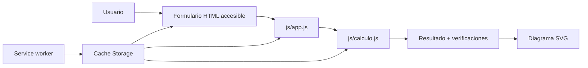
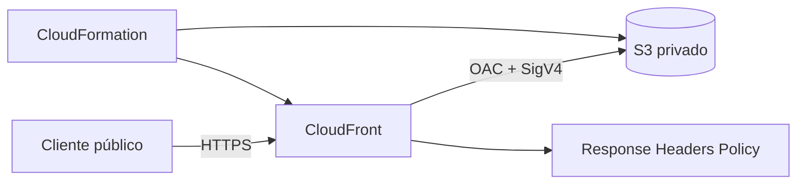

# Arquitectura

## 1. Aplicación

Calculadora de Varillas es una PWA estática para estimar el refuerzo longitudinal de columnas de concreto armado. Los datos se procesan localmente; no hay backend, almacenamiento remoto ni telemetría.

| Componente | Responsabilidad |
|---|---|
| `index.html` | Estructura semántica, datos solicitados y panel de resultados |
| `js/calculo.js` | Validación, fórmulas, distribución y alternativas; no usa DOM |
| `js/app.js` | Adaptador entre formulario, motor de cálculo y presentación |
| `js/registro-sw.js` | Instalación, Compartir, tema, ayuda, WCO, conexión y actualización |
| `sw.js` | Precache de los 13 archivos públicos y estrategias offline |
| `manifest.webmanifest` | Nombre, iconos, `standalone` y Window Controls Overlay |
| `css/estilos.css` | Temas, diseño adaptable, zonas WCO, foco y página offline |

La cabecera conserva exactamente cinco controles accesibles: instalar, compartir, tema, restablecer y ayuda. Compartir usa Web Share cuando está disponible; Clipboard API y `execCommand('copy')` son fallbacks y todos usan `window.location.href`. El feedback se publica en una región `status` viva.

Cuando la PWA instalada expone `navigator.windowControlsOverlay`, la cabecera usa las variables `titlebar-area-*`, zonas `drag`/`no-drag` y `geometrychange`. En una pestaña normal o sin esa API, la misma barra funciona como cabecera web.

## 2. Cálculo y ciclo PWA

1. El formulario solicita geometría, materiales, método y varilla.
2. `app.js` normaliza la entrada y llama a `calcularColumna`.
3. `calculo.js` valida rangos, calcula `Ag`/`As`, redondea barras y comprueba separación.
4. La interfaz enlaza errores con sus controles o muestra propuesta, observaciones, alternativas y SVG.
5. `sw.js` precachea el app shell; `VERSION` separa caches y la interfaz ofrece activar una actualización instalada.

Las fórmulas, unidades y limitaciones están en [`CALCULATIONS.md`](CALCULATIONS.md).

## 3. AWS

La plantilla contiene exactamente cinco recursos: bucket, bucket policy, OAC, distribución y política de cabeceras.

- **S3** usa endpoint REST, cuatro Block Public Access, `BucketOwnerEnforced`, SSE-S3 y versionado. No hay website endpoint, CORS ni ACL pública.
- **CloudFront** es el único endpoint público, redirige HTTP a HTTPS y permite solo `GET`/`HEAD`. No define alias, dominio personalizado, WAF ni logs.
- **OAC** firma siempre con SigV4. La política S3 concede únicamente `s3:GetObject` al servicio CloudFront condicionado al ARN de su distribución y deniega transporte inseguro.
- **Cabeceras**: CSP `self` sin inline/eval, `DENY`, `nosniff`, HSTS `max-age=47304000` sin subdominios ni preload, Referrer Policy y permisos same-origin solo para compartir/escribir al portapapeles. Se omite `X-XSS-Protection`.

## 4. Protección operativa

`DeletionPolicy: RetainExceptOnCreate` evita dejar un bucket si falla la creación inicial, pero lo retiene después de una creación correcta. `UpdateReplacePolicy: Retain` evita pérdida por reemplazo. Además, la stack policy deniega `Update:*` para todos los recursos y una creación `prod` activa termination protection antes del primer upload.

`deploy-aws.sh` no actualiza stacks. `review` solo valida; `prepare` crea un change set `CREATE` sin ejecutarlo; `execute` vuelve a inspeccionar ese mismo change set y exige cinco adiciones antes de ejecutarlo. Después verifica origen vacío, protecciones, privacidad, OAC, HTTPS y cabeceras; solo entonces carga la allowlist de 13 archivos e invalida su propia distribución.

## 5. Límites y riesgos

- El dominio predeterminado `cloudfront.net` usa certificado y política TLS administrados por AWS; fijar una versión mínima requiere dominio propio y ACM, fuera de alcance.
- No hay logs de acceso por decisión de alcance y privacidad.
- El bucket versionado retenido puede acumular costos.
- No se modelan interacción P–M, esbeltez, segundo orden, cortante, confinamiento sísmico completo ni cimentación.
