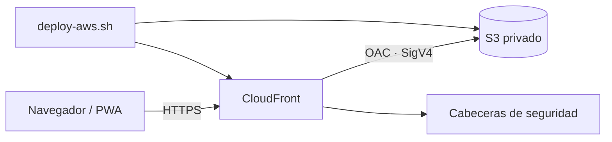

# Despliegue seguro en AWS

Esta guía permite publicar una instancia propia de la PWA con **Amazon S3 privado + Amazon CloudFront + Origin Access Control (OAC)**. No usa el endpoint público de sitio web de S3.

> **Sin estado real versionado:** este repositorio no contiene ni afirma un despliegue activo. Usa marcadores `<YOUR_...>` y guarda los outputs únicamente en `.aws-deployment.json`, archivo local ignorado por Git.

> **Costos:** S3, CloudFront, transferencia, solicitudes e invalidaciones pueden generar cargos. La plantilla usa `PriceClass_100`, pero no garantiza costo cero. Revisa AWS Pricing y configura un presupuesto antes de mantener un entorno.

## Arquitectura



CloudFront sirve la URL pública y redirige HTTP a HTTPS. S3 mantiene activos los cuatro controles de Block Public Access y su política solo concede `s3:GetObject` al servicio CloudFront cuando la solicitud proviene de la distribución creada.

## Recursos creados

| Recurso | Propósito | Protección/costo relevante |
|---|---|---|
| Bucket S3 | Archivos estáticos | Privado, SSE-S3, versionado, `DeletionPolicy: Retain` |
| Bucket policy | Lectura del origen | Solo CloudFront OAC y denegación de transporte no seguro |
| CloudFront OAC | Firma SigV4 hacia S3 | Sustituye OAI para un despliegue nuevo |
| CloudFront distribution | CDN y HTTPS | `PriceClass_100`, HTTP/2 y HTTP/3; certificado predeterminado administrado por AWS |
| Response headers policy | CSP, HSTS y otras cabeceras | Bloquea recursos que no pertenecen al mismo origen |

No crea usuarios, claves de acceso, roles IAM, certificados, zonas DNS, WAF ni buckets de logs.

## Credenciales y permisos

Requisitos:

- AWS CLI v2;
- una cuenta y región elegidas explícitamente;
- un rol o perfil de **mínimo privilegio** capaz de administrar esta plantilla y subir sus objetos;
- permiso para generar una invalidación de CloudFront.

Prefiere credenciales temporales mediante AWS IAM Identity Center (SSO), un rol asumido o la cadena estándar del entorno. Evita credenciales administrativas para el uso habitual y nunca guardes claves, tokens, perfiles, cuentas, ARN, outputs ni estado local en Git.

Con perfil normal o SSO:

```bash
aws sso login --profile <YOUR_AWS_PROFILE>
aws sts get-caller-identity --profile <YOUR_AWS_PROFILE>
```

Sin `--profile`, AWS CLI delega en su cadena estándar de credenciales:

```bash
aws sts get-caller-identity
```

Antes de aplicar, revisa que la cuenta y el principal devueltos sean los previstos. Si no puedes determinar si una cuenta o recurso es de producción, trátalo como producción y detente antes de modificarlo.

## 1. Revisar sin modificar AWS

Desde la raíz del repositorio, ejecuta el modo de revisión sin `--apply`:

```bash
./scripts/deploy-aws.sh \
  --profile <YOUR_AWS_PROFILE> \
  --region <YOUR_AWS_REGION> \
  --stack <YOUR_STACK_NAME> \
  --environment <YOUR_ENVIRONMENT>
```

`--profile <YOUR_AWS_PROFILE>` es opcional y admite perfiles normales o SSO. Si se omite, se usa la cadena estándar. La región, el stack y el entorno siempre son obligatorios.

El modo de revisión valida herramientas, archivos locales, identidad, plantilla y propiedad de un stack existente. Solo ejecuta lecturas de AWS; no crea change sets ni modifica recursos. Muestra localmente la cuenta, región, `DeploymentId`, `StackId` si existe y SHA-256 de la plantilla.

El modo de escritura exige `--confirm-account <YOUR_AWS_ACCOUNT_ID>` y `--confirm-template-sha <YOUR_TEMPLATE_SHA256>`. Al actualizar también exige `--confirm-stack-id <YOUR_STACK_ARN>`.

## 2. Desplegar tras una revisión aprobada

Después de revisar identidad, cuenta, región, permisos, costos y hash:

```bash
./scripts/deploy-aws.sh \
  --profile <YOUR_AWS_PROFILE> \
  --region <YOUR_AWS_REGION> \
  --stack <YOUR_STACK_NAME> \
  --environment <YOUR_ENVIRONMENT> \
  --confirm-account <YOUR_AWS_ACCOUNT_ID> \
  --confirm-template-sha <YOUR_TEMPLATE_SHA256> \
  --apply
```

Para actualizar un stack existente, agrega:

```bash
--confirm-stack-id <YOUR_STACK_ARN>
```

El script:

1. vuelve a verificar identidad, cuenta, región y SHA;
2. comprueba marcador, repositorio, proyecto, entorno y `DeploymentId` de cualquier stack existente;
3. crea un change set sin ejecutarlo y muestra cada cambio;
4. rechaza eliminaciones o reemplazos de infraestructura;
5. ejecuta únicamente el change set revisado;
6. aplica una stack policy que impide reemplazar o eliminar el bucket y la distribución durante actualizaciones;
7. activa protección de terminación cuando el entorno elegido es `prod`;
8. obtiene bucket y distribución desde outputs verificados;
9. rechaza enlaces simbólicos y objetos S3 ajenos a la allowlist;
10. publica recursos primero y el service worker/HTML al final, sin `sync --delete`;
11. invalida `/*`, espera la finalización y ejecuta el smoke test HTTPS;
12. escribe `.aws-deployment.json` con permisos restrictivos para uso local.

La creación inicial de CloudFront puede tardar varios minutos. No desactives protección de terminación u otras salvaguardas en un entorno activo sin aprobación explícita.

## 3. Verificar

La URL se obtiene localmente con:

```bash
aws cloudformation describe-stacks \
  --stack-name <YOUR_STACK_NAME> \
  --query "Stacks[0].Outputs[?OutputKey=='SiteUrl'].OutputValue" \
  --output text \
  --profile <YOUR_AWS_PROFILE> \
  --region <YOUR_AWS_REGION>
```

El perfil es opcional. Pruebas recomendadas:

```bash
curl -I "<YOUR_CLOUDFRONT_URL>/"
curl -I "<YOUR_CLOUDFRONT_URL>/sw.js"
curl -I "<YOUR_CLOUDFRONT_URL>/manifest.webmanifest"
```

Comprueba además:

- el bucket rechaza acceso público directo;
- la calculadora devuelve 8 barras para 30 × 50 cm, 1 % y 5/8";
- DevTools → Application muestra manifest y service worker activos;
- una segunda carga funciona en modo offline;
- no hay errores en la consola;
- Network muestra CSP, HSTS y `X-Content-Type-Options`.

No copies los outputs en archivos versionados. `.aws-deployment.json`, `deployment-outputs.json` e `infra/packaged.yaml` están ignorados.

## Actualizar la aplicación

1. Cambia el código.
2. Si modificaste el app shell, incrementa `VERSION` en `sw.js`.
3. Valida localmente.
4. Repite el modo de revisión y confirma los valores exactos mostrados en tu terminal.
5. Aplica solo después de revisar el change set y su impacto.

CloudFormation no recrea recursos si la plantilla no cambió; el script actualiza objetos y realiza la invalidación. La PWA avisará cuando el navegador instale un worker nuevo.

## Rollback

- **Infraestructura:** CloudFormation revierte una actualización fallida automáticamente.
- **Contenido:** el bucket tiene versionado. Identifica el `VersionId` apropiado en tu cuenta y restaura esa versión; luego invalida CloudFront.
- **PWA:** restaura `sw.js`, incrementa de nuevo `VERSION` y publica. No reutilices una versión de caché ya distribuida.

Inspección de solo lectura:

```bash
aws s3api list-object-versions \
  --bucket <YOUR_PRIVATE_BUCKET_NAME> \
  --prefix sw.js \
  --profile <YOUR_AWS_PROFILE>
```

## Eliminación segura

Eliminar un stack interrumpe el sitio. El bucket usa `DeletionPolicy: Retain`, por lo que eliminar el stack **no elimina sus objetos**. Los entornos `prod` pueden tener protección de terminación. `destroy-aws.sh` comprueba marcador, tags, tipos, `StackId`, entorno y cuenta; nunca desactiva esa protección ni purga datos.

Primero revisa sin modificar:

```bash
./scripts/destroy-aws.sh \
  --profile <YOUR_AWS_PROFILE> \
  --region <YOUR_AWS_REGION> \
  --stack <YOUR_STACK_NAME>
```

El perfil es opcional. Si la protección está activa, la eliminación se detiene. Desactivarla es una decisión separada, potencialmente destructiva, que requiere aprobación explícita y no está automatizada aquí.

Procedimiento general:

1. Confirma que la URL no tenga usuarios ni dependencias.
2. Conserva los outputs y una copia de las versiones necesarias fuera de Git.
3. Revisa la identidad, el StackId inmutable y el entorno.
4. Elimina explícitamente el stack solo tras recibir aprobación.
5. Verifica qué bucket quedó retenido.
6. Elimina versiones y bucket únicamente con una aprobación separada para pérdida de datos.

La limpieza de versiones es irreversible y se deja deliberadamente fuera de los scripts.

## Dominio personalizado (opcional)

Para `<YOUR_CUSTOM_DOMAIN>` se necesita:

1. certificado ACM en `us-east-1`;
2. alias en la distribución;
3. registro DNS hacia CloudFront;
4. actualización de `id`, `start_url` y, si cambia la ruta base, `scope` del manifest.

No agregues el dominio hasta tener control de DNS y un proceso de renovación/validación del certificado.

## Observabilidad y presupuesto

Este despliegue académico no activa logs de acceso por defecto. Antes de un uso operativo, decide explícitamente:

- destino privado de CloudFront standard logging;
- retención, cifrado y acceso a logs;
- alarma o presupuesto de costos;
- AWS Config, CloudTrail y GuardDuty según las políticas de la cuenta;
- responsable y periodo de revisión.

## Fuentes

- [AWS: restringir acceso a un origen S3 con CloudFront OAC](https://docs.aws.amazon.com/AmazonCloudFront/latest/DeveloperGuide/private-content-restricting-access-to-s3.html)
- [AWS: comenzar con un sitio estático seguro y CloudFormation](https://docs.aws.amazon.com/AmazonCloudFront/latest/DeveloperGuide/getting-started-secure-static-website-cloudformation-template.html)
- [AWS: requerir HTTPS entre viewers y CloudFront](https://docs.aws.amazon.com/AmazonCloudFront/latest/DeveloperGuide/using-https-viewers-to-cloudfront.html)
- [AWS CloudFormation: configuración de certificado de viewer](https://docs.aws.amazon.com/AWSCloudFormation/latest/TemplateReference/aws-properties-cloudfront-distribution-viewercertificate.html)

Content was rephrased for compliance with licensing restrictions.
